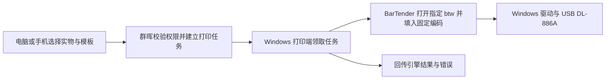

# BarTender `.btw` 模板与直接打印接入分析

分析日期：2026-10-20。下文保留开发前针对 LabOS 0.7.0、群晖 Linux Docker、Windows USB 连接的 DL-886A（NEW）及本机 BarTender 2016 R7（文件版本11.0.7.3146）的能力核实和实施方案。

后续用户已授权实施，0.8.0源码新增原生模板、打印站和任务、Windows COM打印助手及已有对象母版派生，见[打印助手操作指南](BARTENDER_AGENT.md)。0.8.0该轮未启动真实COM或执行USB打印；0.8.1新增纸张设置、模板图预览、CMD入口和当前用户登录后台。下文保留初次调研的结论与建议，“当时没有／尚未实现”的部分由下面的实施补充替代。实际许可、原生导出与USB仍未验，不能把源码、文档或替身测试当作硬件验收。

## 0.8.2交付与验证边界

0.8.2已公开为验证版（prerelease），双架构离线镜像包已完成本机下载与完整核验；交付入口见[版本说明](CHANGELOG.md)。

当前安装与操作使用同版0.8.2应用、`bartender-agent.ps1`和`bartender-agent.cmd`，具体入口见[打印助手指南](BARTENDER_AGENT.md)。菜单1检查本机、2保存初始化配置、4登记下次登录后台，均不向LabOS通信或领取；3才立即持续处理网页队列，包含打印和预览，需保持窗口打开。后台要求该Windows用户登录，安装4本身不启动。0.8.1已冻结，但随后真实Docker生命周期门禁的打印站断言遗漏动态`busy:false`字段而失败，候选Release未公开；保留0.8.1标签、镜像、源码ZIP及失败证据。0.8.2仅修正测试断言并同步版本，实际发布状态见[版本说明](CHANGELOG.md)。纸张覆盖和原生模板图预览的最低助手协议仍为0.8.1，补丁未提高协议门槛。

0.8.2冻结提交为`7298bd7d2ab5df2184c2f8eb518428adf0fef5ee`／`v0.8.2`。构建`39383264290`成功，真实PG18回归208/208、41份JavaScript语法检查通过。验证`39383653140`／运维提交`25240aa88739757b7d56153c01ef27c6f8f106c1`四门禁成功：匿名双架构拉取与在线Compose、绑定同次执行的PG18持久化证据、本地YML禁止拉取的双架构离线TAR容器、严格可信且无SNI的HTTPS生命周期。PG证据不算第二次独立执行，ARM64容器使用QEMU；云端容器运行与本机离线包完整性分别核验，不代表真实USB输出通过。Windows云端作业仅取得官方成功元数据，未取得原始日志，不报告云端精确项数。

Release `418092209`已公开为0.8.2验证版。本机`artifacts/releases/0.8.2/`共14件、493548986字节，13条摘要及7份独立源附件与冻结ZIP逐字节核对通过；双TAR各含应用、PG18、Caddy三镜像，六份config架构核对通过。公开API核对14件资产，12份非TAR附件匿名完整下载通过，报告为`artifacts/cache/0.8.2/github-release-verification.json`；这不等于匿名完整TAR下载、本机Docker运行或浏览器Release页面验收。冻结后只更新仓库文档，不改源码ZIP、镜像、附件或标签，完整发布记录见[版本说明](CHANGELOG.md)。

2026-10-20，0.8.2 Windows本机重跑Node 3/3（0失败、0跳过）及内部87项，两份PowerShell与一份Node测试文件语法检查通过；Node首项包含内部87项，不相加。HTTP传输使用当前助手实际版本，受保护副本的`-Check`核对0.8.2。证据为`artifacts/cache/0.8.2/windows-agent-node-output.txt`、`windows-agent-mock-report.json`、`windows-agent-syntax-report.json`及`windows-agent-verification.json`；COM、打印机和任务计划仍用替身，没有真实引擎、打印或登录任务登记。

标签、原生任务页面源文件及关联测试共6份已与0.8.1冻结manifest同字节核对，报告为`artifacts/cache/0.8.2/unchanged-ui-source-verification.json`。沿用0.8.1标签与原生任务两项Edge专项的证据，不称为这两项专项重跑；0.8.2全量回归中的Edge全站布局另有新执行。原QA计数、截图、PDF和报告目录保留，详见[标签打印说明](LABEL_PRINTING.md)。

## 0.8.1实施补充与验证边界（历史记录）

网页维护不可覆盖的原生模板、打印站及任务，Windows端通过可信HTTPS主动领取。用户从网页下载同版`bartender-agent.ps1`与`bartender-agent.cmd`，放在同一固定文件夹，双击CMD进入菜单；默认菜单不领取任务，缺少PowerShell 7、脚本或初始化配置时显示指引并保留窗口。CMD只从PATH调用`pwsh.exe`，不调用旧版`powershell.exe`。令牌隐藏输入并由同一Windows用户的DPAPI保护；HTTP 401／403／409、重定向与连接失败分别给受控诊断。

菜单4或`-InstallStartup`在已初始化的稳定运行目录登记当前用户的交互登录任务，以普通权限隐藏窗口运行。当前脚本复制到`<运行目录>/agent/bin/bartender-agent.ps1`，任务显式引用原运行目录，保留同用户的配置和待回执；不保存Windows登录密码。**安装／更新仅登记，下一次登录生效，不立即启动或领取队列**；立即处理需显式选择菜单3。菜单5／`-StopBackground`请求当前周期结束后正常退出，保留登录登记；菜单6／`-UninstallStartup`再移除对应登录任务。两者都保留配置、缓存和待回执，不强杀任务或BarTender。受控`agent.log`按约1MiB轮转。该方式要求Windows用户登录，不是Session0系统服务，也不把商业BarTender引擎打包进群晖容器。

任务的`paper`默认空值，沿用原生母版；显式值为`{widthMm,heightMm,orientation}`，宽高各5–300mm、最多3位小数，方向须与实际宽高一致。助手使用带毫米单位索引的`PaperWidth/Height`和`LabelWidth/Height`、`Orientation`、单行单列及零页边距／页内间距设置，读回`Valid`和四个尺寸，允许0.05mm数值容差。[11][12] 原生设计对象不自动缩放或重排；任一边缩小超过容差即在Print或导出前以`PAPER_REQUIRES_MATCHING_NATIVE_TEMPLATE`拒绝。60×40mm和38.5×30.5mm、横向和纵向须使用适配的Designer母版；`-DeriveTemplate`的可选纸张设置也遵守同一限制。

原生预览是独立的单件任务，覆盖所选首件命名数据源后调用`Format.ExportToFile(path,"PNG",colors,150,btDoNotSaveChanges)`，不调用Print。PNG上限2MiB、宽高各4096像素，检查签名、IHDR及结尾，回执沿用DPAPI日记复送保护。它是Automation可用的**模板图**；真正的`ExportPrintPreviewToImage`要求Enterprise Automation，当前未调用，也不以网页纸张轮廓模拟该原生预览。[13][14] 图片绑定任务快照，改变纸张、模板或实物后重新生成；不能从图像或引擎返回推断实物出纸、送料或贴标成功。

0.8.1也补充COM归属核验：按类型库名称读取`ProcessId`，必要时由`Application.Window.Handle`通过Windows窗口API映射PID；两者有效时必须一致。排除创建前已有PID后，再核对注册EXE、进程名、当前用户SID、会话和启动时间。未证明独占身份时不隐藏、不Print、不Quit该进程，不凭进程差集猜测归属。[15] 对已注册官方EXE使用`LoadTypeLibEx(REGKIND_NONE)`只读核对，确认`Edition`为BSTR、`ProcessId`为I4、毫米枚举为3、24位颜色枚举为4；尺寸为`(BtUnits,Single)`索引属性。类型信息证明接口形态，不证明实际授权或运行成功。

0.8.1 Windows专项完成PowerShell内部87项、Node 3/3及PowerShell语法检查；Node首项包含内部87项，不重复计数。检查用COM、打印机及任务计划替身，覆盖纸张索引反射和读回、缩小拒绝、预览不调用Print、PNG边界、回执复送、进程身份和后台任务登记／卸载。另实际运行了受保护副本的`-Check`入口，以及含空格目录内CMD的缺PS1错误暂停和默认菜单选择0退出，均未领取真实队列或启动COM。证据为`artifacts/cache/0.8.1/windows-agent-mock-report.json`、`launcher-error-final-report.json`和`launcher-console-report.json`；首次手写CMD包装引号的失败记录保留，正确参数调用后通过。

早先2026-10-20一次获准的只读COM诊断未取得可证明独占的进程ID便停止，检查后曾观察到新`bartend`进程PID 35992保留；没有打开模板、SaveAs、Export或Print，也未Quit或强杀该进程。此后的`ProcessId`／窗口回退补丁仅经替身验证，没有再次启动真实COM；不能将旧失败认定为已完成现场修复。实际BarTender许可、真实SaveAs／PNG输出、登录后台、USB出纸和标签校准仍待验收。其他业务和发布门禁由[版本说明](CHANGELOG.md)单独记录。

## 结论与接入边界

可以使用已有 `.btw` 直接打印，也可以让 Windows 上的 BarTender 打开母版、调整其支持的属性后另存为新的 `.btw`。最小可行路线是先在 BarTender Designer 做一份原生母版，业务系统只提供每件物资的数据；每次打印无需重新生成模板。[1][2]

现有网页模板 JSON、HTML、CSV 和 BTXML 都不能通过改扩展名变成 `.btw`。BTXML 是给引擎执行的任务指令，仍需引用实际存在的 `.btw`。对于“从任意网页布局直接生成完整原生模板”，本次查到的 2016 接口不足以证明可以完整覆盖对象创建、版式和驱动设置，不列为已可实现的首版能力。`Formats.Add()` 可以新建文档，但新建空文档不等于已经生成完整可打印的设计。[2][3][4]

建议的职责分工：群晖保存物资、固定编码和打印任务；连接 USB 的 Windows 电脑保存经审核的模板、运行 BarTender 并调用已有打印驱动。浏览器提交任务，手机也可作为任务入口。Windows 打印端需要开机并在线；群晖 Compose 不能代替该电脑上的 BarTender 引擎。[1][5]

## 0.7.0初次调研时的现状（历史记录）

- 本机`bartend.exe`产品版本为2016 R7，文件版本11.0.7.3146。安装目录有Automation／XMLScript帮助及BTXML 2.0 XSD；**安装了文件不代表具有对应授权**，初次调研没有读取许可证或启动软件。后续0.8.1只读COM尝试及副作用另见上节。
- Windows 只读打印机清单包含 `Deli DL-886A(NEW) (副本 1)`，驱动为 `Deli DL-886A(NEW)`、端口 USB003。名称用于本机配置示例，不能硬编码为所有电脑的默认值；清单状态不代表已经出纸或校准通过。
- 当时代码仅有网页系统打印窗口与BarTender CSV导出，没有命令行、COM、BTXML、常驻打印端或原生模板生成。该“没有”的结论已由0.8.0／0.8.1实现替代；网页与CSV路径继续保留，见`src/public/material-labels.js`、`src/public/material.js`及[既有打印说明](LABEL_PRINTING.md)。
- 网页模板保存在当前浏览器的 localStorage，属于 JSON 布局；当前不会同步为 BarTender 模板。CSV 每行一件实物，默认每件一张，重印保留原有编码。

## 2016 版本的接口与授权区别

以下依据官方 **2016** 帮助，不能据此推断本机实际购买／激活了哪一档。没有把新版 REST、Print Portal 或新版设计接口套到当前安装。

| 路线 | 官方能力 | 对本项目的用途与限制 |
| --- | --- | --- |
| Designer 打开 `.btw` 并连接 CSV | 已有文本数据库与字段绑定工作流 | 最快落地，先人工确认纸张、字段和试打；数据库功能是否获许可仍需在本机确认 |
| 命令行调用 `.btw` | `/F` 模板、`/AF=` 限定活动文档、`/D` 文本数据、`/PRN` 打印机、`/C=n` 每项份数、`/S=n` 序列数量；`/FPD` 强制使用数据库并显示打印窗口，`/FP` 强制数据库方式打印 | 官方标注自动控制需要 Automation 或 Enterprise Automation；适合小验证，但不能仅凭进程退出认定物理完成 [5][6] |
| COM：打开、赋值、`Format.Print()` | 返回打印结果与诊断消息，可选择等待打印过程返回 | Automation 或 Enterprise Automation；建议作为直接打印首选验证接口，须处理错误和超时 [1][7] |
| COM：`Format.SaveAs()` | 将打开的文档另存为 `.btw`，可指定是否覆盖 | Automation 或 Enterprise Automation；适合基于母版生成新模板文件，覆盖应默认关闭 [2] |
| COM：`PageSetup` | 设置带单位的纸张／标签尺寸、方向和行列，读取有效性 | Automation或Enterprise Automation；本版显式设置后读回，拒绝缩小母版，不自动重排对象 [11][12] |
| COM：`Format.ExportToFile()` | 将模板导出为图像 | Automation或Enterprise Automation；本版单件PNG图使用此方法，不调用Print [13] |
| COM：`Format.ExportPrintPreviewToImage()` | 导出每页打印预览 | **Enterprise Automation**；与模板图不同，本版未调用此方法 [14] |
| COM：`Application.XMLScript()` | 提交 BTXML 并返回 XML 响应 | 官方 2016 方法页要求 **Enterprise Automation**，不能笼统说普通 Automation 也能用此入口 [8] |

`PrintOut()` 没有返回值，`Print()` 能返回结果和诊断，因此新集成优先核实后者。[1][7][10] 命令行的 `/P` 默认影响全部打开文档，需明确 `/AF=` 范围；`/FP` 的 F 指强制数据库方式，并非只打印当前文档。另需区分 `/S=n` 序列数量和不带等号的 `/S` 保存命令。[6] 不以“目录内有 SDK／帮助文件”或“手动打印可用”替代授权验证。

## 怎样制作和复用真正的 `.btw`

### 首选：Designer 制作母版，业务数据独立

1. 在 Windows 的 BarTender 中选择已安装的打印机驱动，按实物纸张配置宽、高、间隙和方向。调研时用户尚未确定标签尺寸；后续0.8.1明确为60×40mm和38.5×30.5mm，需各自校准母版。
2. 放置原生 Code128 对象、QR Code 对象和需要的文本。Code128 与编码文本使用 `Code`，二维码使用完整 `QRPayload`，不能让打印软件再次加前缀、流水或序列化。
3. 选择一种供数方式：人工数据库打印使用 CSV 字段；自动逐件赋值使用同名的“命名数据源”。CSV 列名、命名数据源名和设计对象名是三个不同概念，必须在母版中明确绑定，不能只改对象名。
4. 保存如 `unit-csv.btw` 或 `unit-api.btw`，经预览、首张试打和回扫后再用于批量打印。实际运行不需要每瓶另存一份 `.btw`。

复用当前完整 12 列，不另造一套物资数据接口：

| 字段 | 模板用途 |
| --- | --- |
| `Code` | 单件固定编码，绑定 Code128 和编码文字 |
| `QRPayload` | 完整二维码内容，按原文绑定 |
| `Name` / `Specification` / `Unit` | 物资名称／规格／单位 |
| `CatalogCode` | 物资信息库编码，可按标签用途隐藏 |
| `Region` / `Warehouse` / `Location` | 区域／仓库／存放位置 |
| `Batch` / `ExpiryDate` / `Status` | 批号／有效期／原始单件状态 |

精确契约为 `src/public/material-labels.js` 的 `csv()`：UTF-8 BOM、CRLF、全字段双引号，编码保留前导零。仓库优先显示名称，旧记录无名称时回退原编码。CSV 是导出时快照，位置变化后需重新取数；不要经 Excel 自动转成数值后再打印。

### 如果要求网页配置后生成 `.btw`

可先验证一条受控路线：Designer 预置需要的对象并命名 → Windows 端打开母版 → 通过 `Format.Objects` 查找已有对象、修改 2016 支持的属性 → `SaveAs()` 输出新 `.btw`。官方 `DesignObject` 列出了 `X`／`Y`、宽高、字号和是否打印等可写属性，但不能由此承诺任意字体效果、所有纸张设置或任意新对象都能自动创建。[2][9]

这条路线生成的是由 BarTender 保存的原生文件。网页 JSON 到这些属性的映射、毫米到接口单位的转换、可写属性、隐藏对象、驱动纸张设置及新版文件兼容 2016，都需单独验证。第一步应只做一份固定母版的字段和位置调整，不先做完整的网页设计器转译。

## 怎样从网页直接打印

建议流程：



初次调研时没有这条任务链；该结论已由0.8.0／0.8.1的任务接口和Windows打印端替代。实现不改库存入账或编码生成，也没有为此另加Redis或暴露PostgreSQL端口。

初稿建议先在Windows登录用户会话验证，再评估后台。0.8.1已实现当前用户登录后的隐藏后台及可信HTTPS轮询／站点令牌认证；实际授权、字体、驱动和登录后运行仍需现场验证，不能据此假设Session0服务账号也可用。Windows端主动领取，手机浏览器无需直接连接本机端口或启动Windows程序。

需要落到实现中的最小约束：

- 服务端根据获授权的单件 ID 重新取数。复用现有查看范围，不能仅信任浏览器传入的编码、模板路径、XML 或打印机名称；模板和打印机采用管理端维护的白名单。
- 每次任务保存选定实物的数据快照及模板版本／摘要。任务独立数据文件，避免多用户覆盖固定 CSV；一次默认每件 1 张，原编码和二维码载荷不变。现有上限为 1000 件，不无故扩大。
- 一台打印机先串行处理。领取任务防重复；超时或断线后，结果不明的任务交人工核对，不能自动重试导致重复标签。重印作为可追溯的新打印任务，不创建库存或消耗编码流水。
- 状态明确区分“待处理”“引擎已提交／返回”“失败或结果不明”“人工确认完成”。API 返回成功或进入 Windows 队列，不能直接声称实物已贴标成功。
- 自动逐件赋值每次覆盖全部已绑定字段，空值也覆盖，避免上一件位置等数据残留；关闭旧数据库连接、数据输入提示和额外序列化，逐件核对试打。

命令行适合先验证已有模板和驱动；本次未执行任何打印命令。它的详细记录和错误恢复能力需另外处理，不能用 `/X` 随意关闭用户正在编辑模板的 BarTender 会话。

## BTXML 示例：调用模板，不是生成模板

以下只说明单件任务结构。它需要事先建立 `unit-api.btw`，并创建 `Code`、`QRPayload`、`Name`、`Location` 这四个命名数据源；示例均为合成内容，没有对应实物。这里不提供自动执行入口，实际授权确认后再选择 COM 或其他官方接入方式。

```xml
<?xml version="1.0" encoding="utf-8"?>
<XMLScript Version="2.0">
  <Command Name="labos-demo-0001">
    <Print>
      <Format CloseAtEndOfJob="true" SaveAtEndOfJob="false">C:\LabOSPrint\templates\unit-api.btw</Format>
      <PrintSetup>
        <Printer>Deli DL-886A(NEW) (副本 1)</Printer>
        <IdenticalCopiesOfLabel>1</IdenticalCopiesOfLabel>
        <NumberSerializedLabels>1</NumberSerializedLabels>
        <UseDatabase>false</UseDatabase>
        <EnablePrompting>false</EnablePrompting>
      </PrintSetup>
      <NamedSubString Name="Code"><Value>DEMO-UNIT-000001</Value></NamedSubString>
      <NamedSubString Name="QRPayload"><Value>DEMO-UNIT-000001</Value></NamedSubString>
      <NamedSubString Name="Name"><Value>演示物资</Value></NamedSubString>
      <NamedSubString Name="Location"><Value>演示柜 A-01</Value></NamedSubString>
    </Print>
  </Command>
</XMLScript>
```

XML 标签和数据必须由标准 XML 写入器转义，不能拼接未经处理的用户内容。本例已通过本机安装的 `btxmlscript_2.0.xsd` 及其包含文件的结构校验，未执行任务。结构通过不能证明模板存在、命名数据源匹配、许可可用或打印机实际出纸。

## 初次调研建议的验证顺序与边界（历史记录）

初稿建议先确认BarTender实际授权和纸张尺寸，用现有CSV校准母版，再验证COM并开发网页链路。后续用户已授权开发，任务链和受控母版派生已有源码实现；首张、连续多件、中文／前导零／长码、位置偏移与回扫、真实`Print()`错误返回及`SaveAs()`仍不能由替身测试代替。

初次调研只读核对安装版本、驱动清单、当时代码及官方2016帮助，没有启动BarTender、读取授权秘密、生成真实`.btw`、调用COM或打印，也没有改应用版本、镜像、冻结附件、数据库或NAS配置。后续实施和0.8.1只读COM尝试由上节追加记录，不用这条历史边界概括当前全部工作。

## 官方资料

下列为官方 2016 帮助；部分索引使用西班牙语路径，但当前正文为英文。以本机实际授权和运行验证补足文档结论。

1. [Format.Print 方法与 Automation 授权](https://help.seagullscientific.com/2016/en/Subsystems/ActiveX/Content/PrintJob_Method.htm)
2. [Format.SaveAs 方法与原生另存](https://help.seagullscientific.com/2016/en/Subsystems/ActiveX/Content/SaveAs_Method.htm)
3. [Formats.Add 新建文档](https://help.seagullscientific.com/2016/en/Subsystems/ActiveX/Content/Add_Method.htm)
4. [BTXML 打印任务示例](https://help.seagullscientific.com/2016/es/Subsystems/BTXML/Content/Printing_Labels.htm)
5. [命令行自动控制及授权要求](https://help.seagullscientific.com/2016/en/Content/HID_HELP_COMMAND_LINE_PARAMETERS.htm)
6. [命令行参数汇总](https://help.seagullscientific.com/2016/en/Content/file_command_params_command_summary.htm)、[打印命令](https://help.seagullscientific.com/2016/en/Content/CmdLine_Printing.htm)及[文档命令](https://help.seagullscientific.com/2016/en/Content/CmdLine_BarTender.htm)
7. [Print 与 PrintOut 的打印工作流](https://help.seagullscientific.com/2016/en/Subsystems/ActiveX/Content/printing_formats.htm)
8. [Application.XMLScript：Enterprise Automation 要求](https://help.seagullscientific.com/2016/en/Subsystems/ActiveX/Content/XMLScript.htm)
9. [已有设计对象属性](https://help.seagullscientific.com/2016/en/Subsystems/ActiveX/Content/DesignObject_Object.htm)及[Format.Objects 访问](https://help.seagullscientific.com/2016/en/Subsystems/ActiveX/Content/Objects_Property.htm)
10. [PrintOut 返回 void](https://help.seagullscientific.com/2016/en/Subsystems/ActiveX/Content/PrintOut_Method.htm)
11. [PageSetup对象及Automation授权](https://help.seagullscientific.com/2016/en/Subsystems/ActiveX/Content/PageSetup_Object.htm)、[纸张宽度的单位索引](https://help.seagullscientific.com/2016/en/Subsystems/ActiveX/Content/PaperWidth_Property.htm)和[Orientation枚举](https://help.seagullscientific.com/2016/en/Subsystems/ActiveX/Content/Orientation_Property.htm)
12. [PageSetup.Valid](https://help.seagullscientific.com/2016/en/Subsystems/ActiveX/Content/Valid_Property.htm)及[页设置自动调整规则](https://help.seagullscientific.com/2016/en/Subsystems/ActiveX/Content/Automatic_Adjustments_to_Page_Setup_Values.htm)
13. [ExportToFile模板图及Automation授权](https://help.seagullscientific.com/2016/en/Subsystems/ActiveX/Content/ExportToFile_Method.htm)
14. [ExportPrintPreviewToImage及Enterprise Automation授权](https://help.seagullscientific.com/2016/en/Subsystems/ActiveX/Content/ExportPreview_Method.htm)
15. [Application.ProcessID](https://help.seagullscientific.com/2016/en/Subsystems/ActiveX/Content/ProcessID_Property.htm)及[Window对象和句柄](https://help.seagullscientific.com/2016/en/Subsystems/ActiveX/Content/Window_Object.htm)
