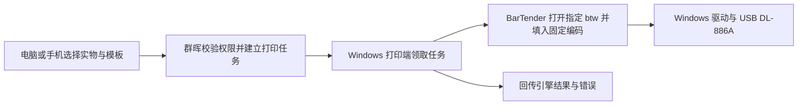

# BarTender `.btw` 模板与直接打印接入分析

分析日期：2026-10-20。下文保留开发前针对 LabOS 0.7.0、群晖 Linux Docker、Windows USB 连接的 DL-886A（NEW）及本机 BarTender 2016 R7（文件版本11.0.7.3146）的能力核实和实施方案。

后续用户已授权实施，0.8.0 源码新增原生模板、打印站和任务、Windows COM 打印助手及已有对象母版派生，见[打印助手操作指南](BARTENDER_AGENT.md)。下文“当前没有／尚未实现”描述调研当时状态，由本次源码实现替代；实际自动测试见[版本说明](CHANGELOG.md)。本轮仍未启动真实 COM、核实授权、生成实机校准后的业务 `.btw` 或执行 USB 打印，不能把实现与替身测试当作硬件验收。

## 结论与接入边界

可以使用已有 `.btw` 直接打印，也可以让 Windows 上的 BarTender 打开母版、调整其支持的属性后另存为新的 `.btw`。最小可行路线是先在 BarTender Designer 做一份原生母版，业务系统只提供每件物资的数据；每次打印无需重新生成模板。[1][2]

现有网页模板 JSON、HTML、CSV 和 BTXML 都不能通过改扩展名变成 `.btw`。BTXML 是给引擎执行的任务指令，仍需引用实际存在的 `.btw`。对于“从任意网页布局直接生成完整原生模板”，本次查到的 2016 接口不足以证明可以完整覆盖对象创建、版式和驱动设置，不列为已可实现的首版能力。`Formats.Add()` 可以新建文档，但新建空文档不等于已经生成完整可打印的设计。[2][3][4]

建议的职责分工：群晖保存物资、固定编码和打印任务；连接 USB 的 Windows 电脑保存经审核的模板、运行 BarTender 并调用已有打印驱动。浏览器提交任务，手机也可作为任务入口。Windows 打印端需要开机并在线；群晖 Compose 不能代替该电脑上的 BarTender 引擎。[1][5]

## 已核实的现状

- 本机 `bartend.exe` 产品版本为 2016 R7，文件版本 11.0.7.3146。安装目录有 Automation／XMLScript 帮助及 BTXML 2.0 XSD；**安装了文件不代表具有对应授权**，本轮没有读取许可证或启动软件。
- Windows 只读打印机清单包含 `Deli DL-886A(NEW) (副本 1)`，驱动为 `Deli DL-886A(NEW)`、端口 USB003。名称用于本机配置示例，不能硬编码为所有电脑的默认值；清单状态不代表已经出纸或校准通过。
- 当前代码仅有网页系统打印窗口与 BarTender CSV 导出，没有命令行、COM、BTXML、常驻打印端或原生模板生成。见 `src/public/material-labels.js`、`src/public/material.js` 及[既有打印说明](LABEL_PRINTING.md)。
- 网页模板保存在当前浏览器的 localStorage，属于 JSON 布局；当前不会同步为 BarTender 模板。CSV 每行一件实物，默认每件一张，重印保留原有编码。

## 2016 版本的接口与授权区别

以下依据官方 **2016** 帮助，不能据此推断本机实际购买／激活了哪一档。没有把新版 REST、Print Portal 或新版设计接口套到当前安装。

| 路线 | 官方能力 | 对本项目的用途与限制 |
| --- | --- | --- |
| Designer 打开 `.btw` 并连接 CSV | 已有文本数据库与字段绑定工作流 | 最快落地，先人工确认纸张、字段和试打；数据库功能是否获许可仍需在本机确认 |
| 命令行调用 `.btw` | `/F` 模板、`/AF=` 限定活动文档、`/D` 文本数据、`/PRN` 打印机、`/C=n` 每项份数、`/S=n` 序列数量；`/FPD` 强制使用数据库并显示打印窗口，`/FP` 强制数据库方式打印 | 官方标注自动控制需要 Automation 或 Enterprise Automation；适合小验证，但不能仅凭进程退出认定物理完成 [5][6] |
| COM：打开、赋值、`Format.Print()` | 返回打印结果与诊断消息，可选择等待打印过程返回 | Automation 或 Enterprise Automation；建议作为直接打印首选验证接口，须处理错误和超时 [1][7] |
| COM：`Format.SaveAs()` | 将打开的文档另存为 `.btw`，可指定是否覆盖 | Automation 或 Enterprise Automation；适合基于母版生成新模板文件，覆盖应默认关闭 [2] |
| COM：`Application.XMLScript()` | 提交 BTXML 并返回 XML 响应 | 官方 2016 方法页要求 **Enterprise Automation**，不能笼统说普通 Automation 也能用此入口 [8] |

`PrintOut()` 没有返回值，`Print()` 能返回结果和诊断，因此新集成优先核实后者。[1][7][10] 命令行的 `/P` 默认影响全部打开文档，需明确 `/AF=` 范围；`/FP` 的 F 指强制数据库方式，并非只打印当前文档。另需区分 `/S=n` 序列数量和不带等号的 `/S` 保存命令。[6] 不以“目录内有 SDK／帮助文件”或“手动打印可用”替代授权验证。

## 怎样制作和复用真正的 `.btw`

### 首选：Designer 制作母版，业务数据独立

1. 在 Windows 的 BarTender 中选择已安装的打印机驱动，按实物纸张配置宽、高、间隙和方向。用户尚未确定标签尺寸；现有 60 × 40 mm 只是示例。
2. 放置原生 Code128 对象、QR Code 对象和需要的文本。Code128 与编码文本使用 `Code`，二维码使用完整 `QRPayload`，不能让打印软件再次加前缀、流水或序列化。
3. 选择一种供数方式：人工数据库打印使用 CSV 字段；自动逐件赋值使用同名的“命名数据源”。CSV 列名、命名数据源名和设计对象名是三个不同概念，必须在母版中明确绑定，不能只改对象名。
4. 保存如 `unit-csv.btw` 或 `unit-api.btw`，经预览、首张试打和回扫后再用于批量打印。实际运行不需要每瓶另存一份 `.btw`。

复用当前完整 12 列，不另造一套物资数据接口：

| 字段 | 模板用途 |
| --- | --- |
| `Code` | 单件固定编码，绑定 Code128 和编码文字 |
| `QRPayload` | 完整二维码内容，按原文绑定 |
| `Name` / `Specification` / `Unit` | 物资名称／规格／单位 |
| `CatalogCode` | 物资信息库编码，可按标签用途隐藏 |
| `Region` / `Warehouse` / `Location` | 区域／仓库／存放位置 |
| `Batch` / `ExpiryDate` / `Status` | 批号／有效期／原始单件状态 |

精确契约为 `src/public/material-labels.js` 的 `csv()`：UTF-8 BOM、CRLF、全字段双引号，编码保留前导零。仓库优先显示名称，旧记录无名称时回退原编码。CSV 是导出时快照，位置变化后需重新取数；不要经 Excel 自动转成数值后再打印。

### 如果要求网页配置后生成 `.btw`

可先验证一条受控路线：Designer 预置需要的对象并命名 → Windows 端打开母版 → 通过 `Format.Objects` 查找已有对象、修改 2016 支持的属性 → `SaveAs()` 输出新 `.btw`。官方 `DesignObject` 列出了 `X`／`Y`、宽高、字号和是否打印等可写属性，但不能由此承诺任意字体效果、所有纸张设置或任意新对象都能自动创建。[2][9]

这条路线生成的是由 BarTender 保存的原生文件。网页 JSON 到这些属性的映射、毫米到接口单位的转换、可写属性、隐藏对象、驱动纸张设置及新版文件兼容 2016，都需单独验证。第一步应只做一份固定母版的字段和位置调整，不先做完整的网页设计器转译。

## 怎样从网页直接打印

建议流程：



当前没有这条任务链；后续开发只需增加任务接口和一个 Windows 打印端，不改库存入账或编码生成，也不需要为此另加 Redis 或暴露 PostgreSQL 端口。

首版打印端可先在 Windows 登录用户会话运行，确认 BarTender 授权、字体和驱动均可用后，再评估开机启动；不要直接假设同一套配置在 Windows 服务账号下也有效。Windows 端主动通过系统可信 HTTPS 领取任务，可避免手机浏览器直接访问本机端口或启动本机程序的兼容问题；具体轮询与认证尚未实现。

需要落到实现中的最小约束：

- 服务端根据获授权的单件 ID 重新取数。复用现有查看范围，不能仅信任浏览器传入的编码、模板路径、XML 或打印机名称；模板和打印机采用管理端维护的白名单。
- 每次任务保存选定实物的数据快照及模板版本／摘要。任务独立数据文件，避免多用户覆盖固定 CSV；一次默认每件 1 张，原编码和二维码载荷不变。现有上限为 1000 件，不无故扩大。
- 一台打印机先串行处理。领取任务防重复；超时或断线后，结果不明的任务交人工核对，不能自动重试导致重复标签。重印作为可追溯的新打印任务，不创建库存或消耗编码流水。
- 状态明确区分“待处理”“引擎已提交／返回”“失败或结果不明”“人工确认完成”。API 返回成功或进入 Windows 队列，不能直接声称实物已贴标成功。
- 自动逐件赋值每次覆盖全部已绑定字段，空值也覆盖，避免上一件位置等数据残留；关闭旧数据库连接、数据输入提示和额外序列化，逐件核对试打。

命令行适合先验证已有模板和驱动；本次未执行任何打印命令。它的详细记录和错误恢复能力需另外处理，不能用 `/X` 随意关闭用户正在编辑模板的 BarTender 会话。

## BTXML 示例：调用模板，不是生成模板

以下只说明单件任务结构。它需要事先建立 `unit-api.btw`，并创建 `Code`、`QRPayload`、`Name`、`Location` 这四个命名数据源；示例均为合成内容，没有对应实物。这里不提供自动执行入口，实际授权确认后再选择 COM 或其他官方接入方式。

```xml
<?xml version="1.0" encoding="utf-8"?>
<XMLScript Version="2.0">
  <Command Name="labos-demo-0001">
    <Print>
      <Format CloseAtEndOfJob="true" SaveAtEndOfJob="false">C:\LabOSPrint\templates\unit-api.btw</Format>
      <PrintSetup>
        <Printer>Deli DL-886A(NEW) (副本 1)</Printer>
        <IdenticalCopiesOfLabel>1</IdenticalCopiesOfLabel>
        <NumberSerializedLabels>1</NumberSerializedLabels>
        <UseDatabase>false</UseDatabase>
        <EnablePrompting>false</EnablePrompting>
      </PrintSetup>
      <NamedSubString Name="Code"><Value>DEMO-UNIT-000001</Value></NamedSubString>
      <NamedSubString Name="QRPayload"><Value>DEMO-UNIT-000001</Value></NamedSubString>
      <NamedSubString Name="Name"><Value>演示物资</Value></NamedSubString>
      <NamedSubString Name="Location"><Value>演示柜 A-01</Value></NamedSubString>
    </Print>
  </Command>
</XMLScript>
```

XML 标签和数据必须由标准 XML 写入器转义，不能拼接未经处理的用户内容。本例已通过本机安装的 `btxmlscript_2.0.xsd` 及其包含文件的结构校验，未执行任务。结构通过不能证明模板存在、命名数据源匹配、许可可用或打印机实际出纸。

## 建议的验证顺序与本轮边界

先确认 BarTender 实际授权和纸张尺寸；用现有 CSV 做一份原生 `.btw` 并完成首张、连续多件、中文／前导零／长码、位置偏移与回扫验收。随后在 Windows 单独验证打开母版、覆盖字段、`Print()` 错误返回和 `SaveAs()`，再开发网页任务链。仅在仍需要网页编辑原生版式时，增加母版派生能力。

本轮只读核对安装版本、驱动清单、现有代码及官方 2016 帮助；没有启动 BarTender、读取授权秘密、生成真实 `.btw`、调用 COM 或打印。没有改应用版本、镜像、冻结发布附件、数据库或 NAS 配置。

## 官方资料

下列为官方 2016 帮助；部分索引使用西班牙语路径，但当前正文为英文。以本机实际授权和运行验证补足文档结论。

1. [Format.Print 方法与 Automation 授权](https://help.seagullscientific.com/2016/en/Subsystems/ActiveX/Content/PrintJob_Method.htm)
2. [Format.SaveAs 方法与原生另存](https://help.seagullscientific.com/2016/en/Subsystems/ActiveX/Content/SaveAs_Method.htm)
3. [Formats.Add 新建文档](https://help.seagullscientific.com/2016/en/Subsystems/ActiveX/Content/Add_Method.htm)
4. [BTXML 打印任务示例](https://help.seagullscientific.com/2016/es/Subsystems/BTXML/Content/Printing_Labels.htm)
5. [命令行自动控制及授权要求](https://help.seagullscientific.com/2016/en/Content/HID_HELP_COMMAND_LINE_PARAMETERS.htm)
6. [命令行参数汇总](https://help.seagullscientific.com/2016/en/Content/file_command_params_command_summary.htm)、[打印命令](https://help.seagullscientific.com/2016/en/Content/CmdLine_Printing.htm)及[文档命令](https://help.seagullscientific.com/2016/en/Content/CmdLine_BarTender.htm)
7. [Print 与 PrintOut 的打印工作流](https://help.seagullscientific.com/2016/en/Subsystems/ActiveX/Content/printing_formats.htm)
8. [Application.XMLScript：Enterprise Automation 要求](https://help.seagullscientific.com/2016/en/Subsystems/ActiveX/Content/XMLScript.htm)
9. [已有设计对象属性](https://help.seagullscientific.com/2016/en/Subsystems/ActiveX/Content/DesignObject_Object.htm)及[Format.Objects 访问](https://help.seagullscientific.com/2016/en/Subsystems/ActiveX/Content/Objects_Property.htm)
10. [PrintOut 返回 void](https://help.seagullscientific.com/2016/en/Subsystems/ActiveX/Content/PrintOut_Method.htm)
